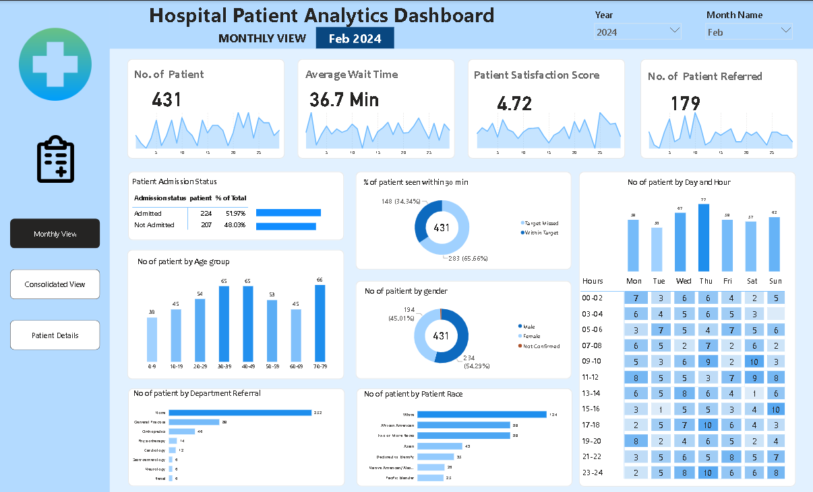
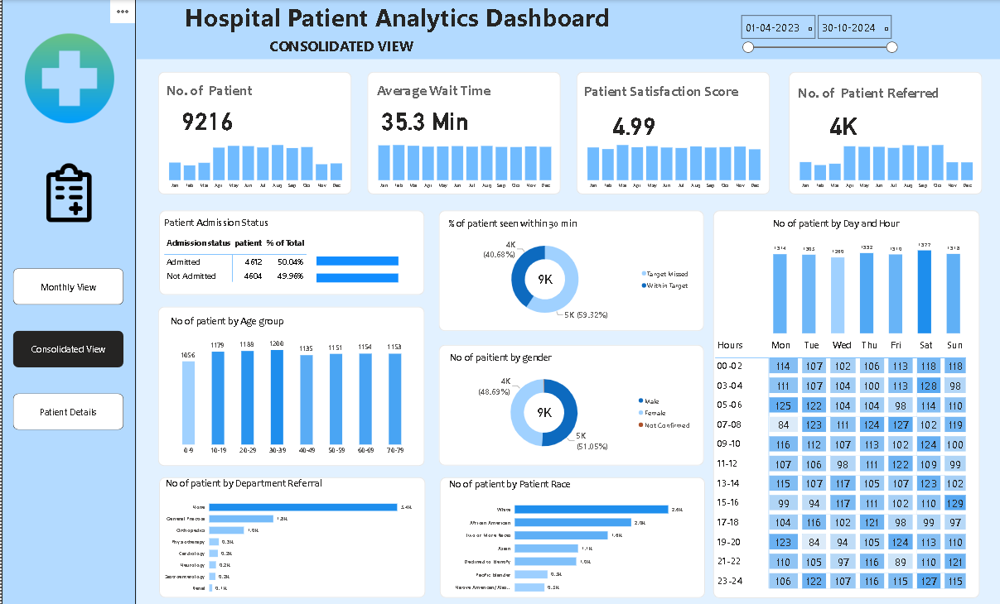
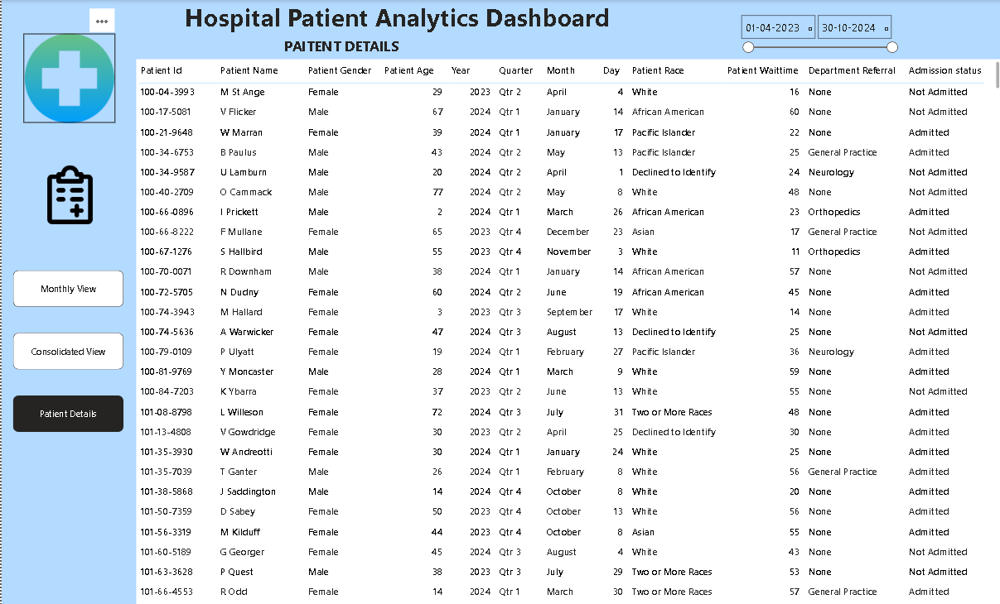

# Hospital-Patient-Analytics-Dashboard

  **Turning Healthcare Data into Meaningful Insights**

## 📌 Project Overview

The **Hospital Patient Analytics Dashboard** is an interactive Power BI project designed to analyze hospital patient data and monitor key healthcare performance indicators.

The dashboard provides insights into patient admissions, waiting times, satisfaction scores, patient demographics, department referrals, and hourly patient trends.

It transforms raw healthcare data into meaningful visual insights, helping hospital management monitor operational performance, understand patient behavior, and make data-driven decisions.

## 🎯 Project Objectives

- Analyze overall patient admissions and referral trends.
- Monitor average patient waiting time.
- Evaluate patient satisfaction scores.
- Identify patient demographics based on age, gender, and race.
- Analyze department-wise patient referrals.
- Track patient visits by day and hour.
- Compare monthly performance with consolidated hospital statistics.

## 📊 Dashboard Pages

### 1. Monthly View
Provides a month-wise analysis of hospital performance with interactive year and month filters.

**Key Insights:**
- Total number of patients.
- Average patient waiting time.
- Patient satisfaction score.
- Number of patients referred.
- Admission vs. non-admission analysis.
- Patient distribution by age group.
- Gender-wise patient analysis.
- Department-wise referrals.
- Patient visits by day and hour.

### 2. Consolidated View
Provides an overall analysis of hospital performance across the selected date range.

**Key Insights:**
- Overall patient volume.
- Monthly KPI trends.
- Admission status distribution.
- Patient demographics.
- Average waiting time trends.
- Department referral analysis.
- Day-wise and hourly patient activity.

### 3. Patient Details
Provides a detailed patient-level view to explore individual patient records.

**Available Information:**
- Patient ID and Patient Name.
- Patient Gender and Age.
- Year, Quarter, Month, and Day.
- Patient Race.
- Patient Wait Time.
- Department Referral.
- Admission Status.

## 📈 Key Performance Indicators (KPIs)

| KPI | Description |
|---|---|
| Total Patients | Overall patient count |
| Average Wait Time | Average patient waiting time in minutes |
| Patient Satisfaction | Average satisfaction score |
| Patients Referred | Total number of referred patients |
| Admission Rate | Percentage of admitted patients |
| Non-Admission Rate | Percentage of patients not admitted |

## 🛠️ Tools & Technologies

- **Power BI** – Interactive dashboard development and data visualization.
- **Power Query** – Data cleaning and transformation.
- **DAX** – Calculated measures and KPI analysis.
- **Data Modeling** – Organizing data for meaningful analysis.
- **Data Visualization** – Charts, KPI cards, donut charts, and heatmaps.

## 💡 Business Insights

This dashboard helps answer important business questions:

1. How many patients visit the hospital each month?
2. What is the average patient waiting time?
3. What percentage of patients get admitted?
4. Which age group contributes the highest patient volume?
5. Which departments receive the most referrals?
6. How does patient satisfaction vary?
7. Which days and hours experience higher patient activity?
8. What are the overall trends in hospital operations?

## ⭐ Key Features

- Interactive dashboard navigation.
- Dynamic monthly and consolidated reporting.
- Date and month-based filtering.
- KPI monitoring.
- Patient demographic analysis.
- Department-wise referral analysis.
- Hourly and daily patient activity heatmap.
- Detailed patient-level reporting.

## 📷 Dashboard Preview

**Monthly View**

**Consolidated View**

**Patient Details**

## 🚀 Conclusion

This project demonstrates how Power BI can be used to convert healthcare data into actionable business insights. It combines data transformation, analytical calculations, data modeling, and interactive visualizations to support better hospital performance monitoring and decision-making.

**Skills Demonstrated:** Data Cleaning | Power Query | DAX | Data Modeling | Data Analysis | Power BI Dashboard Development

Screenshot / Demmos

---

⭐ If you find this project interesting, feel free to explore the repository and share your feedback!
